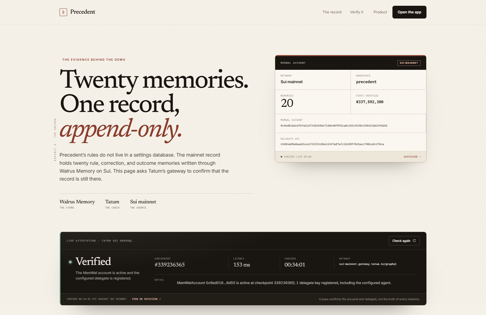
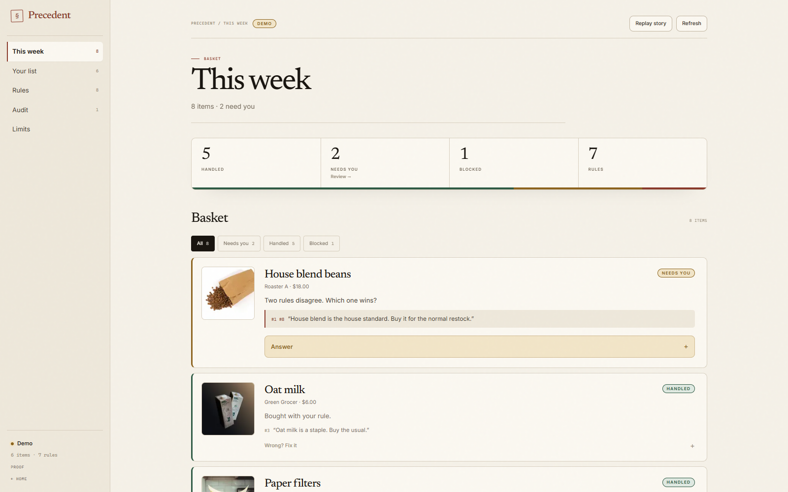

# The memory is the case law.

*Published: https://davee0x.substack.com/p/the-memory-is-the-case-law-building*

### A household agent should remember why it was wrong, not just what it prefers. Precedent is my attempt to build one.

*Total Recall · Track 2 · 6 min read*

Every household has a list of things it buys again and again. Coffee, oat milk, filters, dish soap, the cleaning tablets that keep the grinder from tasting like last month's roast. The list is boring. The arguments around it are not.

*Pay the extra dollar for the good oat milk. Don't buy the store-brand beans; they taste thin. If the coffee jumps more than 15%, switch. Don't touch the subscription.*

Those are not preferences in a profile. They are small rules, with conditions, exceptions, and a history. They are the kind of thing a person learns by being wrong once and then correcting the mistake. Most "AI shopping" products ask you to configure this knowledge up front. That is backwards. You already have the rules. You just don't have a way to hand them over.

## A preference is not a rule

The first version of Precedent looked like every other agent: a chat box and a vector store. You could tell it things and it would try to recall them. It was easy to demo and impossible to trust. A list of remembered sentences cannot tell you which one is current, which one is an exception, or what happens when two of them disagree.

So I rebuilt the memory around a different primitive: the **precedent**. A precedent is a rule with an action, a scope, an optional condition, and the words the user actually used. It is written to memory, numbered, and cited before the next spend. It can be overruled, but it cannot be silently overwritten.

- **Write it.** "The cheaper beans tasted thin. Stay with Roaster A."
- **Cite it.** "House blend beans, $18.00. Cited #7."
- **Overrule it.** The old rule stays. A new one takes authority.

## The conflict is the feature

A normal recommender hides its uncertainty in a score. Precedent has to show it. When two live rules cover the same thing and disagree, the agent does not average them. It stops, names both, and asks the household to rule.

The demo starts with exactly that situation. One rule says house blend beans are the standard. A later rule says that above a 15% price jump, switch to the cheaper roaster. Both are still live. Both cite the same bag of coffee. The agent asks.

When the user answers, the losing side is not deleted. It is **overruled**: a supersession record names the new rule that governs, the old rule stays readable, and the conflict disappears from the audit because it has been settled. That is the whole product in one interaction. Memory is not a pile of text. It is a record of what still has authority.

> The useful question is not "what does this user like?" It is "what did we decide, and why does it still apply?"

## What is actually on the record

The mainnet submission is 20 memories in the `precedent` namespace on Sui mainnet, written through Walrus Memory. They are not a transcript. They are the rules, the correction, the outcome, the observation behind the correction, and the audit finding that made the conflict visible.

- **Network:** Sui mainnet
- **Memories:** 20
- **Namespace:** `precedent`
- **MemWal account:** `0x9ed016de2fbfa51d73363495e7158e40f8761a0c253c9198c430423d624f6d55`
- **Delegate:** `43d54a89a0aadd1a1ef32233c86e14347a87afc1b109ff0cbacc700ca9c276ca`

The public demo is deliberately pointed at a separate, resettable store. Walrus Memory is append-only, and a visitor should be able to replay the story without appending to the record I submitted. The app labels itself **Demo** for that reason. The proof page is the bridge between the two: it checks the mainnet account and delegate live, so the record is never just a screenshot.

*The proof page verifies the MemWal account and delegate through Tatum's Sui GraphQL gateway. The checkpoint moves; the account does not.*

## Why Walrus, why Tatum

The point of putting case law on Walrus is not that a JSON file is hard to store. It is that the record should outlive the app, the model, and the prompt. A rule that was cited before a purchase, and then overruled by the person who owns the money, is exactly the kind of thing that should be append-only and independently readable.

Tatum's Sui GraphQL gateway is the witness. The proof page asks the chain whether the MemWal account is active and whether the configured delegate key is registered. It does not trust the app's own database for that answer. The check is cached for a minute and shared between concurrent requests, because the free plan is three requests a second and a demo should not trip its own rate limit.

**One honest limitation.** Walrus can prove that a memory exists and who wrote it. It cannot prove that the sentence inside is true. Precedent treats memory as authority, not truth: the household's ruling is what gives a rule force, and the record shows when that ruling changed.

## What the demo shows

The app is a normal reorder dashboard, not a chat window. This week's basket is already sorted into handled, needs you, and blocked. The rules are visible. The audit is visible. The memory drawer shows the exact lines that were written, including the supersession record.

*The seeded story: eight items, five handled, two questions, one hard block. The coffee conflict is the one worth settling.*

If you only have two minutes: open the ledger, answer the coffee question, and watch the audit clear. Then open the proof page and press "Check again." That is the loop the whole product is built around: a rule is cited, a person rules, the record keeps both.

## What I would build next

The obvious next step is outcomes. A rule should get stronger when the household actually likes the result, and weaker when it returns the bag. That is already sketched in the memory format; it needs a real order feed behind it. After that: shared households, where two people can hold different rules and the agent has to ask who has authority, and a notification path for the questions that should not wait for someone to open a dashboard.

But the core idea is finished enough to show. A household agent should not be a profile with a chat box. It should keep a record of its own reasoning, cite it before it acts, and let the people who live with the consequences overrule it without erasing the past.

---

**Precedent** was built for Tatum × Walrus: Total Recall, Track 2.

[Live demo](https://precedent-household.vercel.app/) · [The record](https://precedent-household.vercel.app/proof) · [Source](https://github.com/Daveboss123/precedent)
